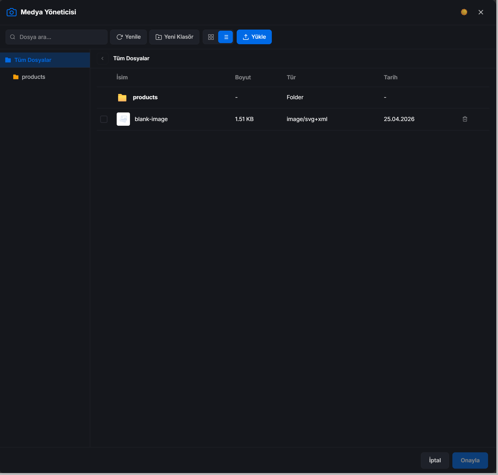

# Laravel Media Manager



A reusable media library for Laravel: a Vue 3 modal (or embedded screen) on top of
[Spatie Laravel MediaLibrary](https://spatie.be/docs/laravel-medialibrary). It is mounted with plain
JavaScript, so it works in any admin theme — and it follows the theme's **light/dark mode and primary
colour** automatically (built and tuned for Metronic, works with shadcn-style variables out of the box).

- **Library** – grid & list, drag & drop and multi-file upload with progress / cancel / retry, search, type filter,
  sorting, infinite scroll, multi-select (Shift-range, Ctrl+A), bulk move / copy / delete
- **Folders** – nested virtual folders mirrored on disk, rename, move (drag & drop), safe delete
- **Theme variants + crop** – the host passes the image sizes its theme needs; every upload produces them
  (`photo-128x128.jpg`, `photo-256x256.jpg`, …) from the untouched original, with a crop / rotate / flip editor
- **Viewer** – full-screen lightbox with previous/next, zoom & pan, keyboard shortcuts, **video playback**, PDF preview, download fallback
- **Picker** – single / multiple, max limit, reorderable selection, preselected media, modal or embedded (`container`)
- **Details** – name, alt text, title, description, dimensions, duration, variants, copy URL
- **Safety** – authenticated routes, optional Gate, SVG rejected by default, duplicate detection, "in use" check before delete
- **i18n** – English and Turkish included, extend by publishing the lang files

## Requirements

PHP 8.1+, Laravel 10–13, `spatie/laravel-medialibrary` ^11, the **GD** extension (image processing; `exif` is
recommended for phone photos). FFmpeg + ffprobe are optional (video posters, duration, resolution).

## Installation

```bash
composer require yazilim360/laravel-media-manager
php artisan vendor:publish --tag=media-manager-assets --force   # public/vendor/media-manager/*
php artisan migrate
php artisan storage:link                                         # when using the public disk
```

Optional publishes: `--tag=media-manager-config`, `media-manager-views`, `media-manager-lang`, `media-manager-migrations`.

> **Upgrading from 1.x** – read [Upgrade notes](#upgrade-notes). Re-publish the assets after every update.

### Authentication (important)

All routes (page and JSON API) sit behind `config('media-manager.route_middleware')`, which defaults to
`web,auth`. With several guards use the guard-specific middleware, either in `.env`

```env
MEDIA_MANAGER_MIDDLEWARE="web,auth:admin"
MEDIA_MANAGER_GATE=manage-media        # optional: also require Gate::allows('manage-media')
```

or in the published config (`'route_middleware' => ['web', 'auth:admin']`).

## Usage

### Mount point

Render one element anywhere in your layout. The Blade component below does it for you; with plain JS:

```html
<link rel="stylesheet" href="{{ asset('vendor/media-manager/media-manager.css') }}">
<script src="{{ asset('vendor/media-manager/media-manager.js') }}" defer></script>

<div id="media-manager-root"
     data-translations="{{ json_encode(trans('media-manager::media-manager')) }}"
     data-config="{{ json_encode(\Yazilim360\MediaManager\Support\ClientConfig::toArray()) }}"></div>
```

`ClientConfig::toArray()` exposes only the settings the browser needs (never the whole config file). The
manager mounts itself; `window.MediaManager` is available when the script has run (and a
`media-manager:ready` event is dispatched on `document`).

### `MediaManager.open(options)`

```js
MediaManager.open({
    multiple: true,          // default false
    max: 5,                  // max selectable files when multiple
    types: ['image'],        // 'image' | 'video' | 'document' – restricts listing AND upload
    sidebar: true,           // folder tree visible
    folder: 'themes/default/products', // open (and create) this folder path
    selected: [12, 15],      // preselect media ids (keeps their order)
    select: true,            // false = library only, no "Select" button
    rememberFolder: true,    // re-open in the folder the user last used (ignored when `folder` is given)
    container: '#host',      // embed in an element instead of a modal
    locale: 'tr',            // 'en' | 'tr' (or any locale you added)
    theme: 'auto',           // 'auto' (follow the host) | 'light' | 'dark'

    variants: [...],         // see below
    crop: true,              // show the crop editor after upload (default true when variants have a ratio)

    onSelect(files) {},      // files = array of media objects (below), in the user's order
    onClose() {},
})
```

`MediaManager.close()` closes it. Escape closes the top-most layer first (dialog → editor → viewer → manager).

### Theme variants & crop

Different themes need different image sizes and aspect ratios. The host (e.g. your theme layer) passes them on every
`open()`:

```js
MediaManager.open({
    types: ['image'],
    variants: [
        { name: 'thumb',   width: 128, height: 128 },      // exact size
        { name: 'card',    width: 256, height: 256 },
        { name: 'product', ratio: '3:4' },                 // largest 3:4 crop, full resolution
        { name: 'banner',  ratio: '16:9', width: 1280 },   // height derived from the ratio
    ],
    onSelect(files) {
        files[0].variants.thumb.url      // → /storage/media-manager/12/variants/photo-128x128.jpg
        files[0].variants.product.width  // → actual pixel size, e.g. 750
        files[0].url                     // → the untouched original
    },
})
```

- Every upload creates all variants from the **original**, which is never modified. File names carry the
  size: `{original}-{WIDTH}x{HEIGHT}.{ext}`.
- Variants with the same aspect ratio share one crop. The editor shows **one step per distinct ratio** (1:1, 3:4, …);
  the user can drag the crop box, resize it from the corners, zoom (wheel / slider), rotate in 90° steps and flip. Skipping a
  step keeps the automatic centred crop.
- Rotate/flip/crop are applied server-side to the original (flip → rotate → crop → resize), so there is no quality loss and
  the result is identical to what the editor shows. EXIF orientation is honoured, PNG/WebP transparency is kept
  (JPEG is flattened on white).
- The specs and the user's crops are stored with the media, so **Crop & rotate** in the details panel re-opens the editor
  where the user left it. Opening it with different `variants` (a theme switch) regenerates the sizes for the new theme.
- `default_variants` in the config is used by `php artisan media-manager:regenerate-variants` and the
  `POST /files/{id}/variants` endpoint when no specs are sent.
- SVG and animated GIF sources are not processed (only the first GIF frame is). Sources larger than `max_dimension`
  (default 8000 px on a side) are stored but not processed (`variants_status: failed`) to protect PHP's memory.
- `queue => true` (`MEDIA_MANAGER_QUEUE=true`) renders variants in a queued job (`variants_status: pending → ready`).

Regenerate variants for existing images, for example after switching theme:

```bash
php artisan media-manager:regenerate-variants --specs='[{"name":"card","width":256,"height":256}]'
php artisan media-manager:regenerate-variants --folder=themes/default --stored   # use each media's own stored specs
```

### The media object

Everything the 1.x contract returned is still there (`id`, `uuid`, `name`, `file_name`, `mime_type`, `type`, `size`,
`size_human`, `url`, `conversions`, `thumb_url`, `collection`, `folder_id`, `folder_name`, `custom_properties`,
`created_at`). New in 2.0:

```json
{
  "width": 1600, "height": 1000, "duration": null,
  "alt": "Red sneakers", "title": null, "description": null,
  "variants": { "thumb": { "url": "…/photo-128x128.jpg", "width": 128, "height": 128, "ratio": "1:1", "file": "photo-128x128.jpg" } },
  "variants_status": "ready", "crops": { "1:1": { "x": 0, "y": 50, "width": 300, "height": 300, "rotate": 90, "flipX": false, "flipY": false } },
  "editable": true
}
```

### Blade component

```blade
<x-media-picker
    button-text="Choose image"
    :multiple="true" :max="5"
    :variants='[["name"=>"card","width"=>256,"height"=>256],["name"=>"product","ratio"=>"3:4"]]'
    folder="themes/default/products"
    on-select="onPicked" />

<script>function onPicked(files) { /* … */ }</script>
```

### Integration recipes

```js
// Product gallery: preselect, keep order, replace the field value
MediaManager.open({
    multiple: true, max: 8, types: ['image'],
    selected: currentIds,
    variants: themeVariants,
    onSelect: (files) => setGallery(files.map(f => ({ id: f.id, thumb: f.variants.thumb.url }))),
})

// Remove / replace a single image: call open() again with `selected: [id]`; an empty `onSelect` result never fires,
// so clear the field in your own "remove" button.

// Embedded library screen
MediaManager.open({ container: '#media-page', select: false, sidebar: true })

// TinyMCE
tinymce.init({
    file_picker_callback(callback, value, meta) {
        MediaManager.open({
            types: meta.filetype === 'image' ? ['image'] : meta.filetype === 'media' ? ['video'] : [],
            onSelect: (files) => files[0] && callback(files[0].url, { alt: files[0].alt || files[0].name }),
        })
    },
})
```

## Theming

The stylesheet is namespaced (`.mm-*`) and driven by `--mm-*` tokens. Each token resolves **host variable → built-in
palette**, e.g. `--mm-primary: var(--color-primary, var(--primary, #7239ea))`, so inside Metronic (or any
shadcn-style theme exposing `--background`, `--foreground`, `--card`, `--muted`, `--muted-foreground`, `--border`,
`--input`, `--primary`, `--primary-foreground`, `--destructive`, `--radius`) it picks up your colours and your dark mode
without configuration. The dark mode is read from `html.dark`, `[data-bs-theme]`, `[data-theme]`, `[data-kt-theme-mode]`
(or the OS preference) and is followed live while the manager is open.

Override anything for another theme:

```css
.mm-backdrop {
    --mm-primary: #0ea5e9;
    --mm-radius: 0.375rem;
    --mm-control-h: 2.5rem;
}
```

`theme: 'dark'` / `'light'` forces a mode; if it differs from the host the built-in palette is used.

## Configuration

`config/media-manager.php` (publish with `--tag=media-manager-config`):

| Key | Default | Purpose |
|---|---|---|
| `route_prefix` | `media-manager` | URL prefix of page + API |
| `route_middleware` | `web,auth` | Middleware for every route (`MEDIA_MANAGER_MIDDLEWARE`, comma separated) |
| `authorize` | `null` | Optional Gate ability required on every request (`MEDIA_MANAGER_GATE`) |
| `disk`, `disk_path` | `public`, `media-manager` | Any Laravel filesystem disk (S3 works) |
| `max_upload` | `51200` (KB) | Upload limit; synced to Spatie's `max_file_size` |
| `allowed_types` | images, mp4/webm/mov, pdf, zip, txt | MIME whitelist |
| `allow_svg` | `false` | SVG can carry scripts; if enabled only "clean" SVGs are accepted |
| `duplicates` | `warn` | `warn` (upload + notify) / `reuse` (return the existing media) / `allow` |
| `conversions`, `webp` | thumb/medium/large, `true` | Spatie conversions (grid thumbnails use `thumb`) |
| `default_variants` | `[]` | Fallback variant specs |
| `max_variants`, `max_dimension`, `image_quality` | `12`, `8000`, `85` | Limits for the variant pipeline |
| `queue`, `queue_connection` | `false`, `null` | Render variants on the queue |
| `usage_resolver` | `null` | Class that reports where a media item is used (below) |
| `video_thumb_second`, `video_poster_width`, `ffmpeg_path`, `ffprobe_path` | `1`, `640`, `/usr/bin/…` | Video poster frame / size, binaries (auto-detected when wrong) |
| `default_theme`, `default_view`, `sidebar`, `per_page`, `allowed_locales` | `auto`, `grid`, `false`, `30`, `en,tr` | UI defaults |

PHP limits must exceed `max_upload`: `upload_max_filesize` and `post_max_size`.

### Refuse to delete media that is in use

The package knows nothing about your tables. Tell it where media is used:

```php
use Spatie\MediaLibrary\MediaCollections\Models\Media;
use Yazilim360\MediaManager\Contracts\MediaUsageResolver;

class ProductMediaUsage implements MediaUsageResolver
{
    public function usages(Media $media): array
    {
        return Product::where('image_id', $media->id)
            ->orWhereJsonContains('gallery_ids', $media->id)
            ->pluck('name')->map(fn ($n) => "Product: {$n}")->all();
    }
}

// config/media-manager.php
'usage_resolver' => App\Media\ProductMediaUsage::class,
```

Deleting an item (or a folder with its files, or a bulk delete) that reports usages answers **409** with the list; the UI
shows it and offers "Delete anyway" (`force=1`).

## REST API

All under `/{route_prefix}/api` (JSON, same middleware as the page):

| Method & path | Purpose |
|---|---|
| `GET /files` | `folder_id`, `recursive=1`, `search`, `type=image,video`, `sort=created_at\|name\|size`, `dir`, `page`, `ids[]` |
| `GET /files/{id}` · `PATCH /files/{id}` | Read · update `name`, `alt`, `title`, `description` |
| `POST /upload` | `files[]`, `folder_id`, `variants` (JSON), `crops` (JSON) → `{data, duplicates, warnings}` |
| `POST /files/{id}/variants` | `variants?`, `crops?` – (re)generate variants |
| `POST /files/{id}/poster` | `poster` (image), `second?`, `duration?`, `width?`, `height?` – set a video's thumbnail |
| `DELETE /files/{id}` · `POST /files/delete` | Delete one · `ids[]` (`force=1` overrides the usage check) |
| `POST /files/move` · `POST /files/copy` | `ids[]`, `folder_id` (null = root) |
| `GET /folders` · `POST /folders` | Tree · `name`, `parent_id` |
| `POST /folders/rename` · `/folders/move` · `/folders/ensure` | `id,name` · `id,parent_id` · `path` ("a/b/c") |
| `DELETE /folders/{id}` | `keep_media=1` moves the files to the root, otherwise they are deleted |
| `GET /translations` | `locale` |

Only media owned by the manager is ever listed or modified, so the package can share the `media` table with your own models.

## Artisan commands

```bash
php artisan media-manager:regenerate-variants [--specs=JSON] [--stored] [--folder=path] [--ids=1 --ids=2]
php artisan media-manager:sync-storage-paths [--dry-run]   # repair disk paths that no longer match the folders
php artisan media-library:regenerate                         # Spatie: rebuild thumb/medium/large conversions
php artisan media-manager:doctor                             # environment check with fix hints
php artisan media-manager:video-posters [--force] [--second=2.3]
```

## Video thumbnails (no ffmpeg required)

On upload every video gets a thumbnail frame — YouTube style — shown in the grid, the details panel and as the player's
poster. It is returned in the result as `thumb_url` / `poster_url` (and `conversions.thumb`), next to `width`, `height`
and `duration`. It is created in this order:

1. **On the server with ffmpeg**, when ffmpeg is available (best for huge files and non-browser formats).
2. **In the uploader's browser** otherwise: the browser decodes the video it is uploading, grabs the frame, and sends the
   JPEG (plus duration and size) to `POST /files/{id}/poster`. No ffmpeg, no extra PHP extension — nothing to install on a
   Mac, a Windows laptop or a shared host. Works for what the browser can play (MP4/H.264, WebM, most MOV); a codec the
   browser cannot decode (e.g. HEVC in Chrome) simply stays without a thumbnail.

Either way an upload never fails because of the thumbnail. Extras for the browser path: open a video in the viewer and press
the camera button to **use the current frame as the thumbnail**, or press **Create thumbnail** in the details panel for videos
that have none.

```env
MEDIA_MANAGER_VIDEO_THUMB_SECOND=2.3   # frame to grab (decimals ok); kept inside short clips
MEDIA_MANAGER_CLIENT_POSTER=true       # false = server (ffmpeg) only
# optional, only to let the server make them:
FFMPEG_PATH="C:\ffmpeg\bin\ffmpeg.exe"   # quotes on Windows; auto-detected on the PATH
FFPROBE_PATH="C:\ffmpeg\bin\ffprobe.exe"
```

For files on a remote disk (S3) the browser can only read the frame of a *just uploaded* file or of a URL served with CORS
headers; otherwise use ffmpeg on the server. After changing `.env` run `php artisan config:clear`. Check the setup with:

```bash
php artisan media-manager:doctor                       # PHP extensions, upload limits, storage, ffmpeg, route protection
php artisan media-manager:video-posters                # server-side posters for videos that have none (needs ffmpeg)
php artisan media-manager:video-posters --force --second=2.3
```

## Changelog

**2.0.3** – video thumbnails no longer need ffmpeg: when the server cannot create one the uploader's browser grabs the frame and sends it (`POST /files/{id}/poster`, also reports duration and size); "use this frame as thumbnail" in the viewer and "Create thumbnail" in the details panel; `client_poster` setting; poster URLs carry a cache-buster.

**2.0.2** – video uploads: a misconfigured ffmpeg made Spatie's video conversion throw *after* the file was stored, so the
UI showed an error and every retry created another copy. Posters are now made by a direct, failure-proof ffmpeg call
(`thumb_url`, `poster_url`); ffmpeg/ffprobe are found next to each other and on the PATH; any error after a file has been
stored becomes a warning instead of a 500; the list refreshes after a failed upload; the browser is told the real upload
limit (`min(max_upload, upload_max_filesize, post_max_size)`); new `media-manager:doctor` and `media-manager:video-posters`
commands; `warnings` in the upload response.

**2.0.1** – primary buttons are always white on the purple (a zero-specificity reset no longer overrides component colours); lightbox follows light/dark; overlay buttons readable in light mode; equal-size detail actions with Save and Delete on one row; list rows share one height; the manager re-opens in the last folder (`rememberFolder: false` to disable); the details panel clears when you leave the folder and its preview works for files outside the current listing; the lightbox arrows stay in place at either end so rapid clicks never zoom.

**2.0.0** – see the upgrade notes below.

## Upgrade notes

**To 2.0** (the visible changes first):

1. **Routes now require authentication by default** (`web,auth`). Set `MEDIA_MANAGER_MIDDLEWARE` / `route_middleware`
   to your guard (e.g. `web,auth:admin`). Previously the API was open to anyone.
2. **Re-publish the assets**: `php artisan vendor:publish --tag=media-manager-assets --force`. The Blade views now load
   `vendor/media-manager/media-manager.{js,css}` (no more CDN axios, SweetAlert2 was removed).
3. **Grid thumbnails now actually exist.** In 1.x the conversions were registered with an array argument that Spatie
   ignores, so no `thumb`/`medium`/`large`/`webp` file was ever generated and the grid loaded the originals. Existing
   images get them with `php artisan media-library:regenerate`.
4. Files moved between folders are now moved on disk too (1.x only worked for root ⇄ folder), including their variants.
5. SVG uploads are rejected unless `allow_svg` is true; deleting is limited to media owned by the manager.
6. The `data-config` attribute carries a whitelist (`ClientConfig::toArray()`), not the whole config. Published copies of
   the Blade views from 1.x should be removed (`resources/views/vendor/media-manager`).

The JSON shape of media objects is a superset of 1.x. `open()` options from 1.x keep working (`theme` now also accepts `'auto'`).

## Frontend assets

This repository publishes the compiled frontend (`dist/media-manager.js` and `dist/media-manager.css`) together with the Laravel code. Vue and CSS sources are not included. After every update, republish the assets:

```bash
php artisan vendor:publish --tag=media-manager-assets --force
```

## License

MIT
